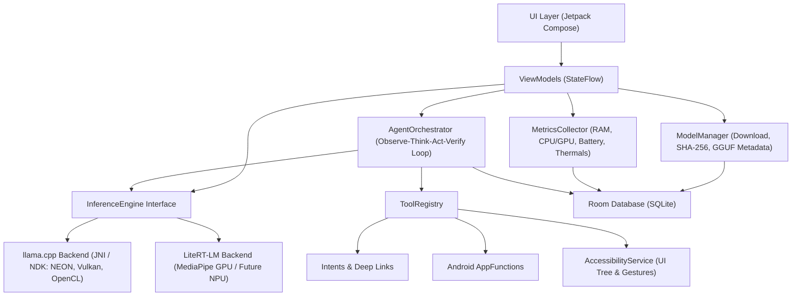

# ChipIT — Product & Technical Specification

> **Version:** 0.1 (Draft)  
> **Platform:** Android only (for now)  
> **License:** MIT  
> **Distribution:** GitHub Releases (sideload APK)  
> **Minimum / Target SDK:** Android 9 (API 28) / Latest Stable Android SDK  

---

## 1. Overview & Vision

**ChipIT** is an Android-first mobile application that lets users load open-weight Large Language Models (LLMs) directly onto their device, choose between **CPU** and **GPU** compute backends, benchmark real-time hardware performance, and empower the locally loaded model to interact with other installed Android applications from a single interface.

Modern smartphones ship with capable multi-core ARM CPUs and mobile GPUs, yet users rarely have visibility into how local models stress memory, thermals, and battery—or a unified, privacy-preserving way to let a local model take actions across apps. ChipIT combines a local inference workbench, a hardware telemetry profiler, and a guarded on-device app agent.

---

## 2. Goals & Non-Goals

### Goals
- Run quantized open-weight LLMs **100% locally** on Android (`arm64-v8a`) with zero cloud dependency.
- Give users explicit control over **CPU vs. GPU** execution, thread counts, context window, and GPU layer offloading.
- Measure and persist granular performance metrics (load time, TTFT, prefill/decode tok/s, PSS RAM, CPU/GPU load, battery drain, thermal state) and enable side-by-side CPU vs. GPU comparison.
- Provide a structured, safety-guarded **App Interaction Agent** that executes user requests across other Android apps via Intents, AppFunctions, and AccessibilityService.

### Non-Goals (v1)
- **Cloud inference or hybrid offloading:** ChipIT does not proxy prompts to remote LLM APIs.
- **On-device training or fine-tuning:** Only inference (GGUF and LiteRT-LM formats) is in scope.
- **iOS support:** Not planned for now; ChipIT targets Android only.
- **Play Store distribution (v1):** Distributed directly via GitHub Releases (sideload APK), Obtainium, and optional F-Droid / IzzyOnDroid channels rather than Google Play.

---

## 3. Target Users & Personas

| Persona | Needs & Motivations | Primary ChipIT Workflows |
|---|---|---|
| **Mobile AI Hobbyist** | Wants to experiment with local models (Llama, Qwen, Gemma, Phi) offline on their phone. | Download GGUF models from Hugging Face, chat offline, test GPU vs. CPU speed. |
| **Developer & Hardware Benchmarker** | Needs reproducible tok/s, memory, battery, and thermal profiles across SoCs (Snapdragon, Dimensity, Tensor). | Run the standard benchmark prompt set, compare CPU vs. GPU charts, export CSV/JSON. |
| **Privacy-Focused Power User** | Wants an AI assistant that automates everyday app tasks without sending screen data or messages to the cloud. | Use the App Interaction Agent with per-app allow-lists and confirmation gates. |

---

## 4. Core Features

### 4.1 Model Library & Loading
- **Direct Hugging Face Discovery (No Bundled Catalog):** Instead of a curated or bundled model list, ChipIT browses and searches **Hugging Face directly** using the HF Hub API (`https://huggingface.co/api/models?filter=gguf&search=...`) and inspects each repository's file tree to list `.gguf` quantization files and exact sizes. Mobile-viable files (~8 GB or less) are shown so users can pick from any compatible model on Hugging Face. LiteRT-LM `.task` / `.litertlm` models are discovered the same way via the `litert-community` Hugging Face organization.
- **Local Import & Resumable Downloads:** Download models with resumable HTTP range transfers (`WorkManager`) or import local `.gguf` / `.task` / `.litertlm` files via the system file picker (SAF).
- **Optional HF Token for Gated Models:** Users can optionally enter a Hugging Face access token (for gated models such as Llama or Gemma), stored locally in `EncryptedSharedPreferences`.
- **Device-Fit Badges & Default Filtering:** For every model file, ChipIT estimates total runtime RAM (`file size + KV cache for selected context + runtime overhead`) and compares it against device RAM (`ActivityManager.MemoryInfo`) and free storage:
  - **🟢 Fits:** Estimated RAM ≤ 60% of total device RAM (and fits in free storage)
  - **🟡 Tight:** Estimated RAM is 60–80% of total device RAM
  - **🔴 Won't fit:** Estimated RAM > 80% of total device RAM, or file exceeds free storage
  - The browser defaults to sorting/filtering by **"Fits my device"**, while still allowing the user to pick any model (warnings are shown for 🟡/🔴, not hard blocks).
- **Integrity, Header & License Metadata:** Parse GGUF headers for parameter count, quantization scheme (e.g., `Q4_K_M`, `Q5_K_S`, `Q8_0`), and context limit; display upstream Hugging Face license metadata before download; and compute/verify **SHA-256** checksums when available.

### 4.2 Compute Backend Selection
All inference backends sit behind a unified `InferenceEngine` interface so ChipIT can swap engines or add hardware targets without changing UI or agent code.

| Engine | Model Format | CPU Backend | GPU Backend | Notes |
|---|---|---|---|---|
| **llama.cpp (JNI / NDK)** *(Primary)* | `.gguf` | ARM NEON / dotprod / i8mm with configurable thread count | Vulkan (primary); OpenCL fallback for Adreno GPUs | Supports partial or full layer offloading (`n_gpu_layers`). |
| **Google LiteRT-LM / MediaPipe LLM Inference** *(Secondary)* | `.task`, `.litertlm` | XNNPACK CPU | GPU delegate (OpenGL/OpenCL/Vulkan) | Provides tuned mobile GPU acceleration and a future upgrade path to **NPU** delegates. |

**Configurable Runtime Parameters:**
- Compute target: `CPU`, `GPU`, or `Hybrid (CPU + N GPU layers)`
- CPU thread count (slider bounded by big/performance core count)
- Context length (`512`, `1024`, `2048`, `4096`, `8192`)
- Sampling controls: temperature, top-p, top-k, repeat penalty, max tokens

### 4.3 Chat
- Streaming token-by-token responses with live tok/s and context usage indicator.
- Configurable system prompt presets (General Assistant, Concise Tool Caller, Benchmark Mode).
- Ability to interrupt/cancel generation mid-stream without unloading the model.
- Persistent multi-turn conversations tied to the active model and backend configuration.

### 4.4 Performance Tracking & Benchmarks
- **Captured Metrics (per session & sampled over time):**
  - **Model Load Time** (ms)
  - **Time to First Token (TTFT)** (ms)
  - **Prefill Speed** (tokens/sec) & **Decode Speed** (tokens/sec)
  - **Memory Usage:** Peak and average app PSS RAM (`Debug.MemoryInfo` / `/proc/self/status`)
  - **Compute Utilization:** CPU % (per-process / core group) and GPU utilization where exposed by vendor/sysfs counters
  - **Battery Impact:** Current draw / charge delta via `BatteryManager` (`mAh` consumed and `% battery per 1,000 tokens`)
  - **Thermals:** Android thermal headroom/status (`PowerManager.getCurrentThermalStatus()`) and battery/skin temperature (°C)
- **Visualization & Comparison:** Time-series charts (tok/s vs. thermal status, RAM over context length) and side-by-side **CPU vs. GPU** run comparisons stored in Room.
- **Standard Benchmark Prompt Set:** Built-in standardized suite (short reasoning, summarization, JSON tool-calling, long-context prefill) for apples-to-apples comparisons.
- **Export:** Export raw samples and summary runs to **CSV** and **JSON**.

### 4.5 App Interaction Agent
ChipIT enables the loaded LLM to interact with other apps from inside ChipIT using a three-tier tool hierarchy ordered from most structured/reliable to most general:

1. **Tier 1 — Android Intents & Deep Links:** Launch apps, open URLs/deep links, share text, set alarms/timers, compose SMS or emails, and open Maps directions using standard Android `Intent`s.
2. **Tier 2 — Android AppFunctions:** Invoke structured actions exposed by target apps that support Android's `AppFunctions` APIs, avoiding fragile UI scraping whenever structured endpoints exist.
3. **Tier 3 — AccessibilityService UI Automation:** When no Intent or AppFunction covers the task, ChipIT's `AccessibilityService` captures a pruned text representation of the active screen's `AccessibilityNodeInfo` tree and performs `tap`, `type_text`, `scroll`, and navigation actions driven by the LLM's JSON tool calls.

- **Guardrails:** Confirmation modal/prompt required before any action that **sends**, **pays**, or **deletes**; per-app allow-list; persistent **Kill Switch** notification/overlay to halt the agent immediately.

---

## 5. User Stories & Key Flows

### Flow A: Load Model, Select Backend, Chat & Inspect Metrics
1. User opens **Models**, searches Hugging Face inside the app (default-filtered to **"Fits my device"**), reviews the 🟢/🟡/🔴 device-fit badge and model license, and downloads a quantization file (or imports a local file).
2. User selects **GPU (Vulkan)**, sets context length to `2048`, and taps **Load**.
3. ChipIT loads the model (recording `load_time_ms`) and navigates to **Chat**.
4. User sends a prompt; tokens stream live alongside a compact HUD showing `TTFT`, live `decode tok/s`, `PSS RAM`, and thermal badge.
5. After the reply completes, user taps **Session Metrics** to view detailed charts.

### Flow B: Run Standard Benchmark & Compare CPU vs. GPU
1. User opens **Benchmarks** and selects a loaded model and the **Standard Suite (4 prompts)**.
2. User runs the suite on **CPU (4 threads)**, then switches backend to **GPU (Vulkan)** and runs it again.
3. ChipIT saves both `BenchmarkRun` records in Room and opens the **Compare** view showing delta in TTFT, decode tok/s, mAh drain, and thermal throttling events.
4. User exports the comparison report as `chipit_benchmark_<timestamp>.json` or `.csv`.

### Flow C: Agent Flow ("Open Spotify and play Lo-Fi Beats")
1. User toggles **Agent Mode** in ChipIT and types: *"Open Spotify and play Lo-Fi Beats."*
2. `AgentOrchestrator` checks `ToolRegistry`: uses Tier 1 Intent / deep link (`open_app` / Spotify search URI) if supported, or launches Spotify and falls back to Tier 3 `AccessibilityService`.
3. Agent observes the serialized UI tree (`[node 4: Search]`, `[node 12: Play]`), thinks via the local LLM, and emits `{"tool":"tap","args":{"node_id":4}}` → types `"Lo-Fi Beats"` → taps Play.
4. If a requested action involves sending a message, confirming a purchase, or deleting data (e.g., *"Send this text on WhatsApp"*), ChipIT pauses execution and presents an **Approve / Cancel** confirmation sheet showing the target app and action payload before proceeding.

---

## 6. Architecture



**Design Principles:**
- **Single-Process Core + Foreground Service:** Long-running inference, downloads, and agent loops run inside a bound Android `ForegroundService` (`specialUse` / `dataSync`) so Android does not kill active model state when ChipIT moves to the background during multi-app agent flows.
- **Engine Isolation:** Native C++ crashes or OOM risks are surfaced cleanly via JNI error codes and checked pre-allocation where feasible.

---

## 7. Agent Tool-Calling Protocol

### Loop Lifecycle: `Observe → Think → Act → Verify`
1. **Observe:** Capture current foreground package name, active Intent/AppFunction availability, and (if Tier 3 is needed and app is allow-listed) a pruned JSON/text summary of interactive `AccessibilityNodeInfo` nodes (assigning ephemeral integer `node_id`s).
2. **Think:** Pass user goal, step history, and observation to the loaded local LLM with a constrained system prompt (and GBNF grammar / JSON schema constraint when using llama.cpp).
3. **Act:** Parse a single JSON tool call, run safety checks (allow-list + risky-action gate), and execute via `ToolRegistry`.
4. **Verify:** Wait for UI settle/idle (bounded timeout), re-observe screen state, and confirm progress toward goal.

### Tool Call Schema & Example
```json
{
  "tool": "tap",
  "args": {
    "node_id": 12
  }
}
```

**Core Tool Catalog:**
- `open_app(package_name)` — Launch an app via package Intent.
- `launch_intent(action, uri, extras)` — Trigger a structured deep link or system action (alarm, share, maps, compose).
- `call_app_function(package_name, function_id, params)` — Execute a Tier 2 AppFunction.
- `tap(node_id)` / `type_text(node_id, text)` / `scroll(direction)` / `navigate_back()` — Tier 3 Accessibility actions.
- `ask_user(message)` — Request clarification or confirmation.
- `done(summary)` — End loop and report result to the user.

### Bounds & Error Handling
- **Max Steps Limit:** Default **12 steps** per task (user-configurable up to 25) to prevent infinite loops on small quantized models.
- **Malformed JSON:** Retry prompt once with schema reminder; if repeated, abort gracefully and surface raw error.
- **Stale `node_id` / Unchanged Screen:** Re-capture the UI tree once; if two consecutive actions produce identical screen hashes, stop and inform the user.
- **Kill Switch:** Tapping **Stop Agent** in the persistent notification or floating chip cancels the coroutine and native inference immediately.

---

## 8. Data Model (Room Entities)

| Entity | Key Fields | Purpose |
|---|---|---|
| `Model` | `id`, `name`, `source_url`, `local_path`, `format` (`GGUF`/`LITERT`), `quantization`, `param_count_b`, `size_bytes`, `sha256`, `est_ram_mb`, `created_at` | Catalogs downloaded/imported local models and verified metadata. |
| `Session` | `id`, `model_id` (FK), `backend` (`CPU`/`VULKAN`/`OPENCL`/`LITERT_GPU`), `threads`, `gpu_layers`, `context_len`, `load_time_ms`, `started_at`, `ended_at` | Represents a chat or inference session under a specific hardware config. |
| `MetricSample` | `id`, `session_id` (FK), `timestamp_ms`, `ttft_ms`, `prefill_tps`, `decode_tps`, `pss_ram_mb`, `cpu_pct`, `gpu_pct`, `battery_mah`, `thermal_status`, `temp_c` | Time-series and per-turn hardware telemetry linked to a `Session`. |
| `BenchmarkRun` | `id`, `model_id` (FK), `suite_name`, `backend`, `config_json`, `avg_ttft_ms`, `avg_prefill_tps`, `avg_decode_tps`, `peak_ram_mb`, `battery_pct_per_1k_tok`, `max_thermal_status`, `created_at` | Summarizes standardized benchmark executions for CPU vs. GPU comparison & export. |
| `AgentActionLog` | `id`, `session_id` (FK), `step_index`, `target_package`, `tier` (`INTENT`/`APP_FUNCTION`/`ACCESSIBILITY`), `tool_json`, `requires_confirm`, `user_approved`, `status`, `error_msg`, `timestamp_ms` | Immutable local audit log of every action taken or attempted by the Agent. |

---

## 9. Permissions & Privacy

- **100% On-Device Processing:** Prompts, model weights, screen UI trees, and metrics never leave the device. Zero analytics or telemetry are transmitted by default.
- **Required Android Permissions:**
  - `INTERNET` (Used strictly for Hugging Face Hub model browsing and downloads; zero prompt or usage data is ever sent)
  - `BIND_ACCESSIBILITY_SERVICE` *(Optional; only requested if user enables Tier 3 Agent Mode)*
  - `POST_NOTIFICATIONS` (Download progress, foreground inference status, and Agent Kill Switch)
  - `FOREGROUND_SERVICE` / `FOREGROUND_SERVICE_SPECIAL_USE` (Keeps model loaded and agent responsive across app switches)
  - Storage / SAF (`ACTION_OPEN_DOCUMENT`) for importing local model files without broad `MANAGE_EXTERNAL_STORAGE` where possible.
- **Not Requested:** `REQUEST_INSTALL_PACKAGES` is **not** requested (updates are distributed externally via GitHub Releases, Obtainium, or F-Droid).
- **Credential Security:** Any optional Hugging Face access token for gated models is stored locally using `EncryptedSharedPreferences`.

---

## 10. Security & Safety

- **Explicit Risk Confirmation:** Any action classified as **sending** (SMS, email, chat message), **paying** (checkout/transfer buttons), or **deleting** (trash/uninstall/remove) pauses the agent and requires explicit user confirmation.
- **Per-App Allow-List:** The `AccessibilityService` only inspects and acts on apps explicitly enabled by the user in **Agent Settings → Allowed Apps**; banking, authenticator, and password manager apps are blocked by default.
- **Password Field Redaction:** Nodes flagged `isPassword == true` or inside sensitive input fields are stripped before UI trees are ever sent to the LLM prompt context.
- **Global Kill Switch:** A persistent high-priority notification action (and optional overlay pill) immediately aborts agent execution and drops the UI tree buffer.
- **Action Audit Log:** Every tool call, target package, confirmation decision, and result is logged in `AgentActionLog` for user inspection.

---

## 11. Performance Targets

Baseline targets measured on a mid-range `arm64-v8a` device (e.g., Snapdragon 7-series / 8 GB RAM) running a **1B–3B Q4_K_M** model at `2048` context:

| Metric | Target |
|---|---|
| **Model Load Time** | < 3.0 s (warm storage) |
| **Time to First Token (TTFT)** | < 1.5 s (short prompt ≤ 256 tokens) |
| **Decode Speed (CPU)** | ≥ 8 tok/s |
| **Decode Speed (GPU)** | ≥ 15 tok/s |
| **Stability / Memory** | Zero OOM crashes when adhering to pre-load RAM warning |
| **Thermal Awareness** | `MODERATE` / `SEVERE` thermal throttling detected within 2 s and surfaced via UI indicator |

---

## 12. Device Requirements

- **OS:** Android 9.0 (API 28) or higher (Android 14+ recommended for optimal `AppFunctions` / thermal APIs).
- **ABI:** `arm64-v8a` only (32-bit `armeabi-v7a` unsupported due to 4 GB virtual address limits).
- **RAM:** 6 GB minimum; **8 GB+ RAM recommended** for 3B+ Q4 models alongside target apps.
- **GPU:** **Vulkan 1.1+** required for Vulkan llama.cpp acceleration (OpenCL fallback available on supported Adreno GPUs).
- **Storage:** 4–10 GB free recommended depending on model sizes.

---

## 13. Tech Stack

| Layer | Choice |
|---|---|
| **Language** | Kotlin + C++20 (NDK / JNI) |
| **UI Framework** | Jetpack Compose (Material 3) + Vico / custom Canvas charts |
| **Architecture** | MVVM + Clean Architecture + Kotlin Coroutines / `StateFlow` |
| **Primary Inference** | `llama.cpp` via NDK (ARM NEON CPU, Vulkan GPU, OpenCL fallback) |
| **Secondary Inference** | Google LiteRT-LM / MediaPipe LLM Inference |
| **Local Database** | Room (SQLite) |
| **Networking / Downloads** | Ktor or OkHttp + WorkManager (resumable Hugging Face downloads) |
| **Model Source** | Hugging Face Hub API (`api/models` + repo file trees; `litert-community` org) |
| **DI & Serialization** | Hilt + `kotlinx.serialization` |
| **Distribution** | GitHub Releases (signed APK) / Obtainium / optional F-Droid & IzzyOnDroid |
| **License** | MIT (open-source; downloaded model weights retain upstream HF licenses) |

---

## 14. Milestones

| Milestone | Scope & Deliverables |
|---|---|
| **M1 — Foundation & CPU Chat** | Project setup, `InferenceEngine` interface, `llama.cpp` JNI build (ARM NEON), Hugging Face Hub browser + device-fit badges / local GGUF loader with SHA-256 & RAM warning, basic Compose Chat. |
| **M2 — GPU Backend & Live Metrics** | Vulkan (and Adreno OpenCL fallback) backend support, GPU layer offload controls, `MetricsCollector` (TTFT, tok/s, PSS RAM, CPU/GPU, battery, thermals), Room persistence. |
| **M3 — Benchmarks & Comparison** | Standard benchmark prompt suite, time-series charts, side-by-side CPU vs. GPU comparison screen, CSV/JSON export. |
| **M4 — Tier 1 & 2 App Agent** | `AgentOrchestrator`, `ToolRegistry`, Intent/deep-link tools, Android `AppFunctions` integration, confirmation modal, `AgentActionLog`. |
| **M5 — Accessibility Agent & Safety** | Tier 3 `AccessibilityService` UI tree pruning + gesture tools, per-app allow-list, password redaction, persistent Kill Switch, LiteRT-LM secondary backend integration. |
| **M6 — Polish & Beta** | Thermal/OOM stress testing across Snapdragon/Mali/Tensor devices, onboarding & permission flows, signed release APK, GitHub Releases CI (GitHub Actions), F-Droid/IzzyOnDroid metadata, public beta. |

---

## 15. Risks & Mitigations

| Risk | Impact | Mitigation |
|---|---|---|
| **Fragmented Mobile GPU Drivers** | Vulkan shaders or OpenCL kernels may crash or run slower than CPU on certain Mali/Adreno drivers. | Run a quick startup capability probe; keep OpenCL fallback for Adreno and allow one-tap fallback to CPU/LiteRT-LM; maintain a device quirk list. |
| **Device RAM Limits & Android LMK** | Loading a 3B+ model while switching to another app during Agent Mode can trigger Android's Low Memory Killer. | Enforce pre-load RAM estimates, run inference inside a Foreground Service, and auto-cap context size (`2048`) on ≤ 6 GB devices. |
| **Sideloading & Android 13+ Restricted Settings** | Sideloading requires enabling "Install unknown apps", and Android 13+ blocks `AccessibilityService` on sideloaded APKs under Restricted Settings until manually unlocked. | All three agent tiers ship in one build with Tier 3 opt-in; guided onboarding walks users through *App info → ⋮ → Allow restricted settings*, while Tiers 1 & 2 work without Accessibility. |
| **Hugging Face Rate Limits, Gated Repos & Large Files** | Unauthenticated HF API throttling, gated model access errors (Llama/Gemma), or interrupted multi-GB downloads on mobile networks. | Cache HF search/tree responses locally, hide files > ~8 GB by default, support an optional encrypted HF token for gated repos, and use `WorkManager` resumable range downloads. |
| **Heat & Battery Drain** | Sustained GPU/CPU inference rapidly heats phones and throttles decode speed. | Surface live thermal status badges, show battery drain per 1k tokens, and automatically warn or pause benchmarks at `THERMAL_STATUS_CRITICAL`. |

---

## 16. Resolved Decisions & Open Questions

### Resolved Decisions
- **Platform:** **Android only** (iOS is not planned for now).
- **Model Catalog:** **Direct Hugging Face Hub discovery** (`api/models` + repo file tree for `.gguf` and `litert-community` for `.task`/`.litertlm`, files ≤ ~8 GB) with 🟢/🟡/🔴 device-fit badges and default *"Fits my device"* sorting; no bundled/curated model list.
- **License:** **MIT License**.
- **Distribution:** **GitHub Releases (signed sideload APK)**, Obtainium, and optional F-Droid / IzzyOnDroid channels (no Play Store in v1); all three agent tiers ship in the single build.
- **NPU Acceleration:** Post-v1 (CPU + GPU only in v1; NPU via LiteRT-LM added later behind `InferenceEngine`).

### Open Questions
None currently.

---

## 17. License

ChipIT's application source code is open-source under the **MIT License**.  
Downloaded model weights remain governed by their respective upstream licenses (e.g., Apache-2.0, MIT, Llama Community License, Gemma Terms), which ChipIT displays from Hugging Face metadata before download.
